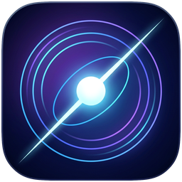

<div align="center">
  
  <h1>Pulsar</h1>
  <p><strong>原生 macOS Liquid Glass 菜单栏 AI 配额监控、多账号安全切换、纯本地 Token 分析与实时 <code>tok/s</code> 测速工具</strong></p>
  <p>
    <a href="https://github.com/rorywang98-netizen/Pulsar/releases/tag/v1.1.0"></a>
    
    
    
    <a href="LICENSE"></a>
  </p>
</div>

---

## 立即下载安装包（macOS Apple Silicon）

> **推荐安装方式**：直接下载打包好的 DMG 镜像，将 **`Pulsar.app`** 拖入 `Applications` 即可使用，零第三方运行时依赖。

| 下载项 | 链接 / 信息 |
|---|---|
| **DMG 直链下载（最新 v1.1.0）** | [**Pulsar-v1.1.0-macOS-arm64.dmg**](https://github.com/rorywang98-netizen/Pulsar/releases/latest/download/Pulsar-v1.1.0-macOS-arm64.dmg) |
| **GitHub Release 发布页** | [Releases · v1.1.0](https://github.com/rorywang98-netizen/Pulsar/releases/tag/v1.1.0) · [Latest Release](https://github.com/rorywang98-netizen/Pulsar/releases/latest) |
| **SHA-256 校验值** | `d5a8b2f91bebd6cbb0b5ae78de856f55bd18aa9d41980fa34a27ff260c4dbc74` |
| **系统要求** | macOS 13.0+（Apple Silicon `arm64`），macOS 26/27 自动启用原生 Liquid Glass 液态玻璃材质 |

### 首次打开说明（本地 Ad-hoc 签名）

当前开源分发包采用本地 ad-hoc 签名（未经过 Apple Developer 公证）。若从浏览器下载后首次打开提示「已损坏」或「无法验证开发者」，将 `Pulsar.app` 拖入 `/Applications` 后在终端执行一次解除隔离属性命令即可正常启动：

```bash
xattr -dr com.apple.quarantine /Applications/Pulsar.app
```

可选校验下载完整性：

```bash
shasum -a 256 Pulsar-v1.1.0-macOS-arm64.dmg
# 应输出: d5a8b2f91bebd6cbb0b5ae78de856f55bd18aa9d41980fa34a27ff260c4dbc74  Pulsar-v1.1.0-macOS-arm64.dmg
```

---

## 核心亮点

### 1. macOS 26/27 原生 Liquid Glass 统一主弹窗
- **通透液态玻璃材质**：基于原生 `NSGlassEffectView`（`OrbitLiquidGlassBackdrop`）与 `GlassEffectContainer` 打造，完整透出桌面光影折射与明/暗自适应高对比度排版；在 macOS 13–15 上自动优雅降级为系统原生 `.popover` 毛玻璃材质。
- **统一高效单弹窗体验**：将完整 Token 分析视图直接合一进菜单栏主弹窗，彻底去除多余的独立分析大窗；顶部「额度与账号 | Token 用量」双标签丝滑切换。
- **5 向原生拖拽自由缩放**：默认 **`390×620pt`**，支持左/右/下边缘及左下/右下角点自由拖拽缩放（范围 **`340–680 × 460–920pt`**），内置 **`超窄 350×560`** / **`标准 390×620`** / **`宽屏 520×720`** 快捷预设与双击底角复位；拉宽至 `≥ 430pt` 时 KPI 自动展开为 `2×2` 网格，`340pt` 极窄宽度下全视图零截断。
- **全新 Pulsar 品牌资产**：配备全套 10 档超椭圆 `AppIcon.icns`、顶栏高清宇宙脉冲星图标（`pulsar.png`）与菜单栏单色自适应反白模板标（`pulsar-template.png`）。

### 2. 六大 AI 服务官方图标与多账号安全切换
内置 6 家服务高清官方 PNG 图标（Codex / Grok 采用单色模板自动适配浅色与深色菜单栏；Antigravity / Cursor / Kimi / DeepSeek 保留官方原色）：

| 服务 | 核心能力 | 认证与配额来源 |
|---|---|---|
| **Antigravity** | 多账号安全切换、Google 真实圆形头像、5h / 周多池配额监控、客户端生命周期控制 | 优先直连本机 `language_server` Connect RPC；远端使用原生 UA 访问 Cloud Code（支持 403 自动回退链路）；完整拆分各模型池 **5 小时** 与 **周** 窗口（含 `Argon · 周`），准确识别 Ultra / Pro 套餐；双装感知 Stable 与 Insiders |
| **Codex** | 多账号安全切换、5h / 本周配额与 Credits 监控、项目侧边栏同步保留 | 只读活跃账号防触发 `refresh_token_reused`；查询 `wham/usage` 与可选 `rate-limit-reset-credits`；自动忽略 `add_*` 附加限流窗口；支持 `file` / `keyring` / `auto` 存储模式及 `.codex-global-state.json` 本地项目保留与回滚 |
| **Grok** | SuperGrok / CLI 配额实时监控 | 只读本地 `~/.grok/auth.json`；主通道 gRPC-web Protobuf，备用代理通道自动回退 |
| **Cursor** | Ultra 多通道 / 附加美元余额 / 账单周期监控 | 非阻塞只读 SQLite3 查询 `state.vscdb` + Electron SafeStorage AES-128-CBC 解密（后台轮询与 CLI 强制非交互绝不弹窗）；并发聚合多端点完整展示 Ultra 多通道、按量附加余额与账单周期 |
| **Kimi** | Kimi Coding 用量监控与 API Key 管理 | 独立 macOS 钥匙串安全存储 API Key，支持自定义 `KIMI_CODE_BASE_URL` |
| **DeepSeek** | 账户余额监控（CNY / USD 多币种）与 API Key 管理 | 独立 macOS 钥匙串安全存储 API Key，实时展示可用余额与多币种汇总 |

### 3. 顶部状态栏深度定制（周额优先 · 5h+周双显 · 多服务并排 · 14 项指标）
- **所见即所得实时预览**：设置页顶部内置菜单栏胶囊实时预览，联动官方品牌图标、脉冲星模板标或纯文字模式。
- **灵活配额窗口与多服务并排**：
  - 支持 **周额度优先（`weeklyFirst`，默认）**、**`5h + 周双显`**（精简 `49%/99%` 或带标签 `5h49/周99`）、**5 小时优先**、**最低短板**。
  - 配额来源支持 **当前选中服务**、**全局最低预警**、**固定单服务** 与 **多服务并排展示**（自由勾选任意服务并排序并排显示在状态栏）。
  - 支持 Antigravity 指定追踪池（`最低池` / `Gemini` / `Claude` / `Argon`）。
- **14 项可勾选排序模块**（每项均附实时预览胶囊）：
  `服务配额 / 余额`、`5 小时额度（独立）`、`周额度（独立）`、`实时速度 (tok/s)`、`近 60 秒均速`、`今日 Tokens`、`今日估算费用`、`当前活跃模型`、`今日缓存命中率`、`今日消息数`、`近 7 天 Tokens`、`近 30 天估算费用`、`最近重置倒计时`、`DeepSeek 余额`。

### 4. 纯本地 `<10ms` 实时 `tok/s` 测速引擎
- **100% 离线只读，零网络请求、零子进程**：GUI 每 4 秒通过 POSIX 浅扫描 + 活跃热集缓存 + `pread` 文件尾部轻量采样（稳态耗时 `< 10ms`），绝不触发全盘扫描。
- **科学离群过滤**：自动剔除极短/超时异常样本（`< 0.25s`、`> 180s`、`> 20,000 tok/s`），实时计算当前活跃模型输出速率、近 7 天模型均速/峰值与近 60 秒全客户端合并吞吐。
- **全界面联动**：实时速率同时呈现于顶部状态栏、Token 页「实时与近期模型速度」对比卡片与模型明细排行 `tok/s` 胶囊徽章。

### 5. 本地 Token 用量分析（默认今日 · 自定义日历区间 · 客户端排序 · 5 大自定义卡片）
- **多客户端增量只读扫描**：增量解析本地会话日志（Claude Code 按 `message.id` 跨文件去重、Codex `total_token_usage` 差分增量、Antigravity 多通道合并并关联 `cwd`、Grok、Kimi Code、DSH 进程内动态 `libzstd` 解压、OpenCode / ZCode 只读 SQLite、WorkBuddy），支持无损历史种子合并（`max(seed, live)` 杜绝重复计数）。
- **默认「今日」+ 任意单日 / 自定义日期区间**：
  - 打开 Token 页默认聚焦 **今日**，一键切换 `今日 | 7天 | 30天 | 全部` 或点击 **自定义** 弹出原生单日日历（`.graphical`）/ 区间双选择器与 5 枚快捷芯片（`昨日` / `近 3 天` / `近 14 天` / `本周` / `本月`）。
  - 点击 **近 16 周活跃热力图** 任意日期格即可秒切当日单日分析；区间 `≤ 180` 天自动补齐连续自然日零值柱，`> 180` 天自动稀疏保性能；支持离线精确模型排行与本地 JSON 导出（`NSSavePanel`）。
- **客户端筛选栏滚轮横滑 & 自由排序**：
  - 筛选栏支持 **鼠标滚轮丝滑横向滑动**（`orbitHorizontalWheelScroll`）。
  - 支持 **直接拖拽换位**、**右键菜单**（移到最前 / 向前 / 向后 / 移到最后 / 恢复默认）以及设置页与弹窗「卡片」面板双向管理，自定义顺序自动持久化至 `registry.json`。
- **5 大可自定义卡片**（勾选开关 + ↑/↓ 排序 + 紧凑密度）：
  1. **核心 KPI 指标卡**（总量四分项进度条、估算费用与日均、缓存命中率、消息数与活跃天）
  2. **实时与近期模型速度**（实时脉冲状态、近 60s 吞吐、近期活跃模型均速对比条）
  3. **近 16 周活跃热力图**（自适应宽度、悬停预览、点击切换单日）
  4. **每日趋势柱图**（Tokens / 费用自由切换、跨年标签与滚轮横滑自适应）
  5. **深度明细排行表**（客户端 / 模型含 `tok/s` 徽章 / 本地 `cwd` 项目三标签切换）

---

## 零 Claude 联网与核心安全承诺

- **严格零 Claude 联网与零凭据触碰**：
  - 配额监控与快照导出仅覆盖 Antigravity / Codex / Grok / Cursor / Kimi / DeepSeek 6 个非 Claude 服务；
  - 本地 Token 用量与实时 `tok/s` 测速引擎（`TokenUsageModels.swift` / `TokenUsageEngine.swift` / `TokenUsageViews.swift`）全程 **0 `URLSession`、0 `Process(`**，仅离线只读本机已落盘会话日志，**零网络请求 Anthropic 接口、零拉起 Claude CLI、零读取 Claude 钥匙串凭据**。
- **绝不自动 `SIGKILL`**：多账号切换控制客户端时先验证目标凭证有效，再优雅调用 `NSRunningApplication.terminate()` / `SIGTERM` 并等待 12 秒；超时直接中止并提示，仅用户显式确认才允许强制结束，切换后仅重启切换前运行过的应用。
- **保护 Codex 单次 Refresh Token**：后台轮询严格只读当前活跃 Codex 账号，非活跃账号刷新经内存门控 + 跨进程 `flock` 锁串行执行并即时轮换落盘。
- **零命令行明文与严格权限**：钥匙串写入通过 `/usr/bin/security -i` stdin 通道完成（绝不经 `argv` 传参）；大凭证采用分片 + SHA-256 校验与代际轮换；本地状态、头像缓存、归档与快照均按目录 `0700` / 文件 `0600` 原子 `fsync + rename` 落盘。

---

## 从源码构建、测试与打包 DMG

要求已安装 Xcode Command Line Tools（Swift 5+ / macOS SDK）：

```bash
git clone https://github.com/rorywang98-netizen/Pulsar.git
cd Pulsar

# 1. 运行全量单元测试（含临时钥匙串、ProcessControl、品牌图标、日期区间、客户端排序、实时 tok/s 测速等）
bash test.sh

# 2. 编译、打包品牌资产并本地签名应用包
bash build.sh

# 3. 打包可分发 macOS DMG 安装镜像及 SHA-256 校验文件（输出至 dist/）
bash scripts/package_dmg.sh

# 4. 可选：安装至 /Applications 并配置开机自启 LaunchAgent
bash install.sh
# 可选参数: bash install.sh --rebuild | --no-start
```

---

## CLI 子命令与数据路径说明

> **底层兼容说明**：为保证既有用户配置、钥匙串命名空间与自动化脚本平滑升级，源码构建产物、数据目录与 LaunchAgent 沿用历史兼容标识符 `RoryOrbit`（Bundle ID：`com.rory.roryorbit`），DMG 分发包内应用名为 **`Pulsar.app`**，二者共享同一套本地配置与钥匙串空间。

```bash
# 查看版本与帮助
/Applications/Pulsar.app/Contents/MacOS/RoryOrbit --version
/Applications/Pulsar.app/Contents/MacOS/RoryOrbit --help

# 纯本地日志扫描并打印脱敏 Token 用量与实时 tok/s 自检表
/Applications/Pulsar.app/Contents/MacOS/RoryOrbit --smoke-usage

# 纯本地日志扫描、写出日归档并输出 1 行脱敏 JSON 摘要
/Applications/Pulsar.app/Contents/MacOS/RoryOrbit --export-usage-archive [--full]

# 全量只读配额自检（输出脱敏摘要表）
/Applications/Pulsar.app/Contents/MacOS/RoryOrbit --smoke-quota

# 导出脱敏号池 JSON 快照（零密钥、零 Claude）
/Applications/Pulsar.app/Contents/MacOS/RoryOrbit --export-accountpool-json [--max-age 240] [--refresh]

# 一次性幂等迁移历史账号与密钥（支持环境变量指定自定义目录）
/Applications/Pulsar.app/Contents/MacOS/RoryOrbit --migrate-legacy
```

### 本地存储与可选环境变量

- **数据目录**：`~/Library/Application Support/RoryOrbit/`（目录 `0700`，核心数据文件 `0600`）
  - `registry.json`：账号元数据与全部界面/状态栏/排序设置（不含任何明文密钥）
  - `avatars/<sha256>.img`：Google 账号圆形头像磁盘缓存
  - `daily-history-archive.json` / `token-history-seed.json` / `token-scan-cache.json` / `token-usage-snapshot.json`：本地 Token 分析与归档缓存
  - `accountpool-snapshot.json` / `.refresh.lock`：号池暖缓存快照与跨进程 `flock` 协同锁
- **独立钥匙串命名空间**：`com.rory.roryorbit.antigravity`、`com.rory.roryorbit.codex`、`com.rory.roryorbit.keys`
- **可选历史迁移环境变量**：
  - `PULSAR_LEGACY_ORBITSWITCH_DIR`：指定自定义 OrbitSwitch 历史备份目录或 `accounts.json` 路径（默认回退 `~/Library/Application Support/OrbitSwitch/accounts.json`）
  - `PULSAR_LEGACY_TOKEN_MONITOR_DIR`：指定自定义历史 Token Monitor 导出目录或 `.json` 路径（默认回退 `~/Library/Application Support/Token Monitor/`）

---

## License

本项目基于 [MIT License](LICENSE) 开源。
